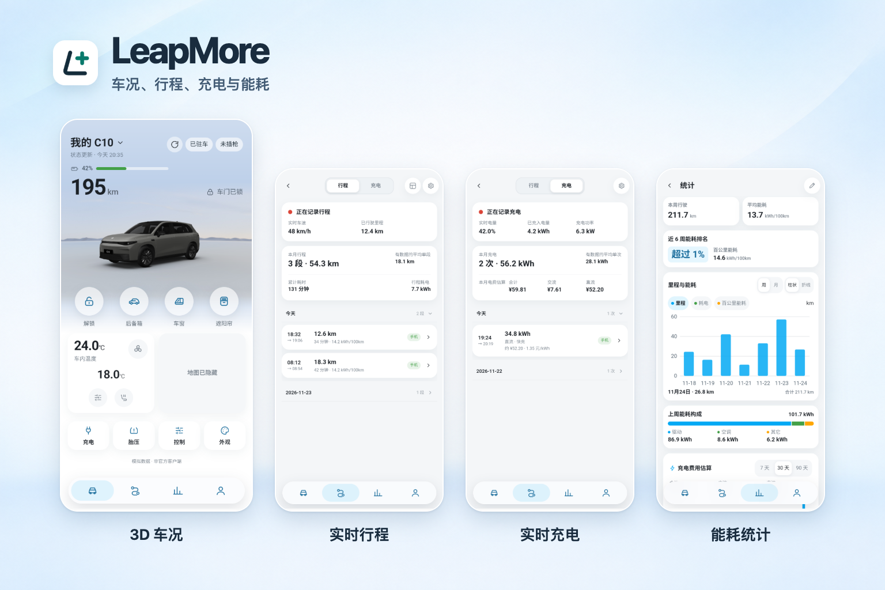

# LeapMore

**开源免费 · 面向中国大陆零跑车主的第三方车辆助手**

用手机看车况、远程控车、记录行程和充电，也可以把同一辆车的 Home Assistant（HA）历史记录同步到手机。LeapMore 可以免费下载和使用，项目代码按 [GNU GPL v3.0](LICENSE)（GPL-3.0-only）发布。版权所有 © 2026 MiRaToo。

## 下载与安装

当前版本为 **0.1.0 预发布**。Android 用户可以在 [GitHub Releases](https://github.com/MiRaToo/LeapMore/releases) 下载 `LeapMore-v0.1.0-android.apk`。iOS 和鸿蒙请参考[源码构建指南](app/README.md)自行编译并签名。

在 App 中打开「我的 → 关于 LeapMore → 检查更新」可查询 GitHub 和 GitCode 上带 Android 安装包的发布，包括预发布。两边有同一版本时会使用你选的首选更新源，也可以从这里直接打开两个源码仓库。

## 界面与功能

介绍图由 Android 模拟器实拍合成，使用演示数据，地图区域已遮盖。

- 在**车况与远控**中查看续航、胎压和车辆状态。驻车时可按车型和账号权限操作门锁、车窗、后备箱和空调，支持操作密码或系统生物识别。[3D 车况](docs/screenshots/vehicle.png) · [车辆控制](docs/screenshots/controls.png) · [空调与加热](docs/screenshots/climate.png)
- **行程与充电**显示实时车速、里程、充入电量和功率，以及每日历史明细。长按可从本机删除行程，HA 原始记录会保留。[行程记录](docs/screenshots/trips.png) · [充电记录](docs/screenshots/charges.png)
- 在**能耗与同步**相关页面按周或月查看能耗、设置电价，并估算交流和直流充电费用。手机与 HA 记录可合并，支持按时间段或全部导出 CSV。[能耗统计](docs/screenshots/statistics.png) · [记录与数据源](docs/screenshots/data-sources.png)
- 通过 **Android 桌面卡片**查看车况并快捷控车。App 内可更换主题和图标。[卡片预览](docs/screenshots/widgets.png)

## 开始使用

1. 打开 App 后使用你自己的零跑账号登录并选车。首次选车时，可以选择车型的电池容量预设，或在「我的 → 车辆管理」中稍后填写。也可以先使用演示账号体验界面。
2. 在「记录 → 记录设置」选择数据源。默认是 **手机记录 + HA 同步**。手机记录由 App 查询零跑云的车辆上报，可在 Android 的后台常驻设置中开启后台轮询。配置同一辆车的 HA 后，手机和 HA 的重叠记录会去重。
3. 如需连接 HA，在记录设置中进入「HA 同步设置」，填写自己的服务器地址并授权。只想查看 HA 历史时，也可直接从登录页连接。[LeapToHA 集成](https://github.com/MiRaToo/ha-leapmotor-cn)提供所需的车辆记录。
4. 如需在地图和行程中显示地址，在「我的 → 高德地图 Key」填入你自己的高德 Web 服务 Key。

手机采样可能受到车辆上报、网络和后台限制影响。耗电量与电费包含按 SOC、容量及电价计算的估算，实际金额以充电账单为准。

## 隐私与反馈

系统版本将会话凭据放在设备的安全存储中，历史记录保存在本机。零跑车况、HA 同步和地址查询会访问相应服务。反馈问题前，请移除手机号、车架号、精确位置、令牌和操作密码。

LeapMore 与零跑汽车无隶属关系。遇到问题可在 [GitHub Issues](https://github.com/MiRaToo/LeapMore/issues) 提交版本号、设备系统和复现步骤。

## 赞赏

如果 LeapMore 对你有帮助，欢迎自愿支持项目维护。下载、使用及全部功能均免费。

- 爱发电：[支持 LeapMore](https://afdian.com/a/leaplink)
- 微信：扫一扫下方赞赏码。

